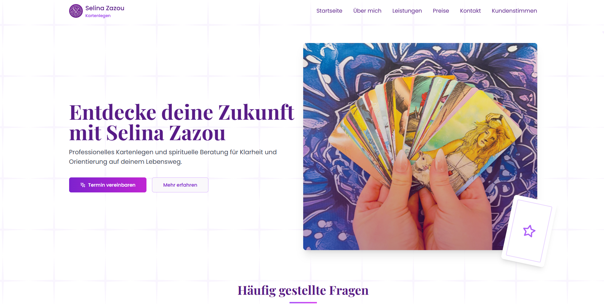

# Kartenlegen & Spirituelle Beratung - Web App

Eine moderne, responsive Webanwendung für spirituelle Lebensberatung, Tarot und Lenormand-Kartenlegen. 
Das Projekt bietet eine interaktive Benutzererfahrung, automatisierte Kontaktformulare und ein modernes Design.

*Hinweis: Dies ist ein deutschsprachiges Projekt (German-language project).*

## 🌟 Live Demo
https://kartenlegen-selinazazou.org/

## ✨ Features
- **Modernes UI/UX-Design**: Flüssige Animationen mit Framer Motion und ein ansprechendes, thematisch passendes Styling.
- **Responsive Layout**: Optimiert für alle Geräte (Desktop, Tablet, Mobile) dank Tailwind CSS.
- **Dynamische Preis- und Service-Auswahl**: Interaktive Karten für verschiedene Beratungsmodelle.
- **Integrierte Zahlungsoptionen**: Vorbereitung für PayPal und SEPA-Überweisung.
- **Serverlose Funktionen (Backend)**: Netlify Functions gekoppelt mit MongoDB zum dynamischen Laden und Speichern von Kundenstimmen (Testimonials).
- **Kontaktformulare**: Direkte E-Mail-Anfragen eingebunden via EmailJS & Formspree.

## 🛠️ Tech Stack
- **Frontend**: React.js, Vite
- **Styling**: Tailwind CSS, Radix UI, Framer Motion
- **Backend / API**: Netlify Functions (Serverless Node.js)
- **Datenbank**: MongoDB (NoSQL)
- **Services**: EmailJS, Formspree, PayPal React SDK
- **Hosting**: Netlify

## 🚀 Lokale Ausführung (Run Locally)

Um dieses Projekt lokal auf deinem Rechner auszuführen, befolge diese Schritte:

1. **Repository klonen**
   ```bash
   git clone https://github.com/dein-username/kartenlegen-website.git
   cd kartenlegen-website
   ```

2. **Abhängigkeiten installieren**
   ```bash
   npm install
   ```

3. **Umgebungsvariablen konfigurieren**
   - Erstelle eine `.env` Datei im Stammverzeichnis des Projekts (nutze `.env.example` als Vorlage, falls vorhanden).
   - Füge die MongoDB Verbindungs-URL hinzu:
     ```env
     MONGODB_URI=deine_mongodb_connection_string
     VITE_PAYPAL_CLIENT_ID=deine_paypal_client_id
     ```

4. **Entwicklungsserver starten**
   ```bash
   npm run dev
   ```
   Die Applikation sollte nun unter `http://localhost:5173` erreichbar sein.

5. **Serverless Functions testen (Optional)**
   Um die Netlify-Funktionen lokal zu testen, nutze die Netlify CLI:
   ```bash
   npm install netlify-cli -g
   netlify dev
   ```

## 📄 Lizenz
Dieses Projekt ist für Demonstrationszwecke und Portfolio-Präsentationen gedacht. Alle Rechte am Inhalt (Bilder, Texte) sind vorbehalten.
